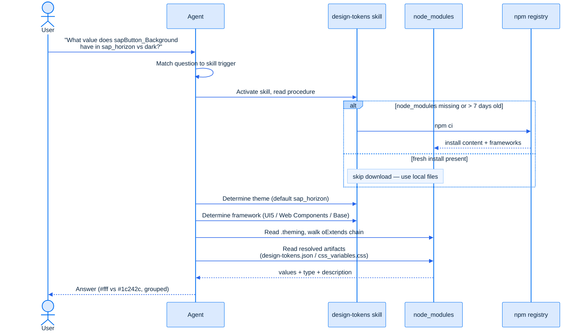

# UI Theme Designer Plugin

General plugin for coding agents working with the UI theme designer [SAP Help pages](https://help.sap.com/docs/btp/sap-business-technology-platform/sap-ui-theme-designer) and the SAP Design System — including [SAP Fiori design tokens](https://github.com/SAP/theming-base-content).

## Key Features

### 📋 Skills

#### ui-theme-designer-help

Answers how-to get started with UI theme designer and conceptual questions about UI theme designer on BTP:

- Initial setup, including user/role management
- Creating, editing, and publishing themes
- Quick, detailed, and expert theming workflows
- Transporting themes, fallback themes, theme sets
- Integration with SAP Build Work Zone, S/4HANA, SAPUI5, SAP GUI
- Troubleshooting and error messages

#### ui-theme-designer-design-tokens

Answers questions about the SAP Design System and SAP Fiori design tokens:

- Which themes exist (e.g. `sap_horizon`, `sap_fiori_3`) and what value a parameter has in each
- How parameters inherit and extend across the theme chain via `.theming` files
- Which parameters a specific UI component consumes — for [SAPUI5/OpenUI5](https://github.com/UI5/openui5), [UI5 Web Components](https://github.com/UI5/webcomponents), and [Fundamental Styles](https://github.com/SAP/fundamental-styles)
- Which hard-coded values in your custom CSS can be replaced by theming parameters, so your styles stay in sync with the SAP Design System and adapt to every theme

## Installation

### For Claude

```sh
claude plugin install ui-theme-designer@claude-plugins-official
```

See [Claude by Anthropic: ui-theme-designer](https://claude.com/plugins/ui-theme-designer).

### For GitHub Copilot

```sh
copilot plugin install ui-theme-designer@awesome-copilot
```

See [Awesome GitHub Copilot: ui-theme-designer](https://awesome-copilot.github.com/plugin/ui-theme-designer/).

### For other coding agents

If your coding agent doesn't support plugins, install the skills directly using the [skills](https://www.npmjs.com/package/skills) package:

```bash
npx skills add SAP/ui-theme-designer-plugins-for-coding-agents
```

See [The Agent Skills Directory: SAP/ui-theme-designer-plugins-for-coding-agents](https://www.skills.sh/?q=SAP/ui-theme-designer-plugins-for-coding-agents).

## How Does the Design Tokens Skill Work?

The `ui-theme-designer-design-tokens` skill does not rely on the agent's training data for parameter values. Instead, it works against the actual source-of-truth artifacts published on npm. When your question matches one of the skill's triggers, the agent activates the skill and reads its procedure. If the local `node_modules` are missing or older than seven days, the skill runs `npm ci` to pull the current theming base content and framework packages; otherwise it reuses the files already on disk. It then determines the relevant theme (defaulting to `sap_horizon`) and framework (UI5, UI5 Web Components, or the base content), follows the `.theming` inheritance chain via the `oExtends` links, and reads the resolved artifacts — `design-tokens.json` or `css_variables.css`. The answer it returns is grounded in those files, including each parameter's value, type, and description.


## What can I do with this?

Real-world tasks where the UI Theme Designer plugin makes your coding agent immediately useful.

### 1. Assess the Impact of a Parameter Change

**Situation:** Before changing a design token (e.g. adjusting `sapBrandColor` or a tile background color in a custom theme), you want to know which components and CSS properties will be affected — so you can review visually and catch unintended regressions early.

**Example:**

> _"Which UI5 Web Components and CSS properties use `sapTile_Background`? I want to understand the blast radius before I change its value."_

**What happens:** The `ui-theme-designer-design-tokens` skill searches the component source of UI5 Web Components, SAPUI5/OpenUI5, and Fundamental Styles for every reference to the parameter. You get a grouped list of affected components and usage contexts — without grepping multiple repositories yourself.

---

### 2. Explore Parameter Dependencies for a Specific UI Area

**Situation:** You are theming a specific part of the UI (e.g. focus indicators, form fields, or navigation) and need to discover all related parameters — including ones you did not know existed.

**Example:**

> _"What theming parameters control the focus ring appearance across SAPUI5 components?"_

**What happens:** The skill maps the `sapContent_Focus*` namespace across UI technologies, shows which parameters exist, what values they carry in each standard theme, and which components consume them. A fragmented multi-repo search becomes a single structured answer.

---

### 3. Compare a Parameter's Value Across All Standard Themes

**Situation:** You are planning a migration from `sap_fiori_3` to `sap_horizon`, or building a multi-theme-aware custom component, and need to know how a specific parameter's value differs between themes.

**Example:**

> _"What value does `sapHighlightColor` have in `sap_horizon`, `sap_horizon_dark`, `sap_fiori_3`, and `sap_belize`?"_

**What happens:** The skill traverses the theme inheritance chain for each requested theme and returns the resolved values side by side — useful for contrast checks, migration planning, and dark-mode testing without needing a running system.

---

### 4. Discover All Parameters for a Semantic Color Role

**Situation:** You want your custom theme to correctly express a semantic color family (e.g. "critical", "negative", "positive", "informative") and need to know which parameters belong to that role across the SAP Design System.

**Example:**

> _"What parameters define the 'negative' color family in `sap_horizon`? I want to make sure my custom theme handles all of them consistently."_

**What happens:** The skill searches the `sap_horizon` parameter space for parameters whose names, annotations, or groupings relate to the negative/error semantic role, and returns a structured list — so you don't miss a parameter that only appears in one framework.

---

### 5. Find Parameters for Charts and Data Visualization

**Situation:** You are theming a dashboard application that uses SAP Charts or custom data visualization components, and need to know which design tokens to use for chart colors, axes, and backgrounds.

**Example:**

> _"What theming parameters exist for charts and data visualization in `sap_horizon`?"_

**What happens:** The skill searches the `sapChart_*` parameter namespace in theming-base-content and across the UI5 framework, returning chart-specific parameters grouped by purpose (category colors, axis lines, backgrounds, labels) — giving you a complete theming surface for your data visualization layer.

---

### 6. Look Up a Parameter's Value in a Dark or High-Contrast Theme

**Situation:** You are testing or validating a custom theme for dark mode or high-contrast accessibility, and need to know the exact parameter values used in `sap_horizon_dark` or `sap_horizon_hcb` without running a live system.

**Example:**

> _"What value does `sapBackgroundColor` have in `sap_horizon_dark` and `sap_horizon_hcb`?"_

**What happens:** The skill resolves the parameter value for both themes by traversing their inheritance chains, so you can verify contrast ratios, plan your overrides, or document expected values — all without a running UI Theme Designer instance.

---

### 7. Build a Custom Component That Looks Like a Standard One

**Situation:** You are adding a new component to your custom library and want it to look and feel consistent with the SAP Design System. You need the exact design tokens that a comparable standard component uses — not just guesses.

**Example:**

> _"I'm building a custom `StatusBadge` component. Which theming parameters should I use for its background, text color, and border to match the style of standard SAP status indicators?"_

**What happens:** The skill identifies parameters used by semantically similar standard components (e.g. `ObjectStatus`, `MessageStrip`) across UI5 Web Components and theming-base-content, and returns them grouped by purpose — giving you a token set you can directly apply in your component's CSS.

---

### 8. Find All Parameters That Changed Between Two Themes

**Situation:** You are migrating a custom theme from `sap_fiori_3` to `sap_horizon` and want to know which parameters were added, removed, or changed in value — so you can update your overrides systematically.

**Example:**

> _"Which parameters exist in `sap_horizon` but not in `sap_fiori_3`, and which have different values?"_

**What happens:** The skill traverses the full parameter set of both themes and returns a structured delta — new parameters, removed parameters, and value changes — giving you a migration checklist grounded in the actual theme data.

---

### 9. Discover Parameters Used by a Specific UI5 Control

**Situation:** You want to customize the look of a specific SAPUI5 control (e.g. `sap.m.Button`, `sap.ui.table.Table`) and need to know which theming parameters it actually consumes so your Custom CSS targets the right tokens.

**Example:**

> _"Which theming parameters does the SAPUI5 `Table` control use? I want to adjust its row background and border colors in my custom theme."_

**What happens:** The skill searches the SAPUI5/OpenUI5 library source for the `Table` control's LESS files and returns every parameter referenced, grouped by visual property — so you know exactly which parameters to override rather than inspecting source code manually.

---

### 10. Check Parameter Annotations for Quick Theming Eligibility

**Situation:** You want to know which parameters are exposed in the Quick Theming panel of the UI Theme Designer, or whether a specific parameter is marked as protected (not intended for direct customer override).

**Example:**

> _"Is `sapHighlightColor` available in Quick Theming in `sap_horizon`? Is it marked as protected?"_

**What happens:** The skill reads the LESS annotation metadata (`// [Quick ...]`, `// [Protected ...]`) for the parameter in the requested theme and reports its theming category and any restrictions — helping you understand which parameters are safe and appropriate for customers to change.

---

### 11. Write Themeable CSS for a Custom UI5 Control

**Situation:** You are developing a custom SAPUI5 control and want to make it properly themeable — using the correct file structure, LESS conventions, and parameter references so it works with the UI Theme Designer.

**Example:**

> _"What file structure and conventions do I need to follow to make a custom SAPUI5 control themeable with the UI Theme Designer?"_

**What happens:** The `ui-theme-designer-help` skill retrieves the official documentation on developing themeable applications — covering the required `library.source.less` structure, base theme files, theme directory layout, and best practices for writing Custom CSS — so you get the authoritative guidance without navigating the help portal.

---

### 12. Check Service Limits Before a Production Rollout

**Situation:** You are preparing to roll out a custom theme to production and want to know whether there are size limits, rate limits, or other service constraints that could affect your deployment.

**Example:**

> _"What are the size and rate limits for custom themes in the UI Theme Designer on BTP? Are there restrictions I should know about before publishing?"_

**What happens:** The skill retrieves the "Theme Limits and Restrictions" and "Rate Limitation" documentation and returns the current limits — so you can validate your theme against them before hitting a constraint in production.

---

### 13. Transport Themes Between Systems

**Situation:** You have finished developing and testing a custom theme in a dev tenant and need to move it to a quality or production system. You want to know the supported transport options and their trade-offs.

**Example:**

> _"How do I transport my custom themes from a development tenant to production on BTP? What are the options?"_

**What happens:** The skill covers both transport paths — manual export/import via the UI Theme Designer UI and automated transport via SAP Content Agent Service — including prerequisites, steps, and known limitations for each approach.

---

### 14. Set Up a Fallback Theme

**Situation:** You want to configure a fallback theme so that users who have an assigned custom theme still get a consistent experience if that theme is unavailable or deleted.

**Example:**

> _"How do I configure a fallback theme in the UI Theme Designer? What happens to users if the fallback theme itself is deleted?"_

**What happens:** The skill retrieves the "Defining a Fallback Theme" and "Theme Fallback" documentation, explaining how fallback chains work, how to set them up, and the edge cases — so you can design a robust theming setup for your users.

---

### 15. Understand Theme Sets and When to Use Them

**Situation:** You have heard about theme sets but are not sure when to use one instead of a standalone theme. You want to understand the concept before deciding on your theming architecture.

**Example:**

> _"What is a theme set in the UI Theme Designer, and when would I use one instead of a regular theme?"_

**What happens:** The skill retrieves the "What is a Theme Set?" and "Customizing Theme Sets" documentation and explains the use case — a theme set bundles multiple themes (e.g. light + dark + high-contrast variants) under a single identifier, so applications can switch between them automatically based on user or system preferences.

---

### 16. Integrate a Custom Theme With SAP Build Work Zone

**Situation:** You have created a custom theme and want to make it available to users in SAP Build Work Zone. You need the end-to-end integration steps.

**Example:**

> _"How do I make my custom theme available in SAP Build Work Zone on BTP?"_

**What happens:** The skill retrieves the "Integrating in SAP Build Work Zone" documentation — covering the configuration steps in both UI Theme Designer and Build Work Zone, required roles, and any known limitations — so you can complete the integration without trial and error.

---

### 17. Apply a Custom Theme to a Standalone SAPUI5 App

**Situation:** You have a standalone SAPUI5 application that is not behind an Application Router, and you want to apply a custom theme from the UI Theme Designer service to it.

**Example:**

> _"How do I apply a custom theme from the UI Theme Designer to a standalone SAPUI5 app that doesn't use an Application Router?"_

**What happens:** The skill retrieves the "Integrating in Standalone SAPUI5 Applications" documentation, explaining how to configure the theme URL, the `sap-theme` bootstrap parameter, and any CORS or CSP considerations — giving you the exact integration path for your app architecture.

---

### 18. Theme SAP GUI for Windows With a Custom Theme

**Situation:** Your organization uses SAP GUI for Windows and you want to know whether the UI Theme Designer can be used to apply a consistent corporate theme to it alongside your web applications.

**Example:**

> _"Can I use the UI Theme Designer to apply a custom theme to SAP GUI for Windows?"_

**What happens:** The skill retrieves the "Integrating in SAP GUI for Windows" documentation and explains what is supported, what the prerequisites are, and what the limitations are — including which SAP GUI versions and theme types are compatible.

---

### 19. Check Accessibility Requirements for Custom Themes

**Situation:** You are building or auditing a custom theme and need to ensure it meets WCAG accessibility requirements — particularly around contrast ratios and focus visibility.

**Example:**

> _"What does the UI Theme Designer documentation say about WCAG contrast requirements for custom themes? Are there built-in accessibility checks?"_

**What happens:** The skill retrieves the "Accessibility Features in UI Theme Designer" documentation and the relevant sections on adding Custom CSS, explaining which accessibility constraints apply, what the tool validates automatically, and what you need to verify manually.

---

### 20. Find Out What's New in the Latest Release

**Situation:** You are a theming administrator or developer catching up after a release cycle and want to know what new features or changes were introduced in the UI Theme Designer recently.

**Example:**

> _"What new features were added to the UI Theme Designer recently?"_

**What happens:** The skill retrieves the "What's New for UI Theme Designer" documentation and returns the latest release notes — so you can quickly identify new capabilities, changed behavior, or deprecated features relevant to your theming setup.

---

### 21. Configure Content Security Policy for a Themed App

**Situation:** Your custom-themed application is being blocked by Content Security Policy headers, or your security team is asking you to document the CSP configuration required for the UI Theme Designer.

**Example:**

> _"What Content Security Policy headers do I need to configure for an application that uses a custom theme from the UI Theme Designer?"_

**What happens:** The skill retrieves the "Content Security Policy" and "Clickjacking Framing Protection" documentation, explaining which directives are required, why they are needed, and how to configure them — so you can resolve CSP issues without guesswork.

---

### 22. Determine Theme ID and Theme Root at Runtime

**Situation:** A custom theme is not loading correctly in your SAPUI5 application, and you need to understand how the app determines which theme is active and where theme files are served from — so you can diagnose the root cause.

**Example:**

> _"How does a SAPUI5 application determine its active theme ID and the theme root URL at runtime? I'm trying to debug why my custom theme isn't loading."_

**What happens:** The skill retrieves the "Determining Theme ID and Theme Root" documentation, explaining the resolution order (URL parameter → bootstrap config → system default), the `sap-theme` parameter format, and how to inspect the active theme — giving you the diagnostic framework to trace the issue.

---

### 23. Self-Host Theme Files Without the UI Theme Designer Service

**Situation:** You want to distribute a custom theme as part of your application's static assets, so it works without a live UI Theme Designer service instance at runtime.

**Example:**

> _"Can I bundle my custom theme files with my application so it doesn't depend on the UI Theme Designer service at runtime? How do I do that?"_

**What happens:** The skill retrieves the "Self-Hosting Themes for Use Without the UI Theme Designer Service" documentation — explaining how to export theme files, where to place them, and how to configure your application to load them from the self-hosted location.

---

### 24. Support Theme Switching via the `sap-theme` URL Parameter

**Situation:** You want users to be able to switch between themes in your SAPUI5 application by appending `sap-theme=<themeId>` to the URL — for example, to let power users test different themes without changing system settings.

**Example:**

> _"How do I enable theme switching via the `sap-theme` URL parameter in my SAPUI5 application?"_

**What happens:** The skill retrieves the "Supporting the `sap-theme` URL Parameter" documentation, explaining the parameter format, how to enable it in your bootstrap configuration, and any security considerations — so you can add this capability safely.

---

### 25. Plan a Theme Migration From `sap_fiori_3` to `sap_horizon`

**Situation:** Your organization is upgrading to `sap_horizon` and you have custom themes built on `sap_fiori_3`. You need a structured approach to migrating them — understanding both the process and the parameter changes involved.

**Example:**

> _"We have custom themes based on `sap_fiori_3`. What steps do we need to follow to migrate them to `sap_horizon`, and which parameters have changed?"_

**What happens:** The `ui-theme-designer-help` skill retrieves the "Migrating Themes" documentation for the procedural steps, while the `ui-theme-designer-design-tokens` skill can provide the parameter delta between the two themes — together giving you a complete migration plan covering both process and data.

---

## Examples

Examples showing in which situations the UI Theme Designer plugin can help you.

### Develop a Custom Component Using Design Tokens of Similar Components

**Situation:** You are building a custom component library and want to add a new component that looks consistent with the SAP Design System. The UI technology doesn't matter — this works with UI5, UI5 Web Components, or any other framework. To make the component themable, you want to reuse the SAP design tokens that standard components of the same type already use.

**Example:** You want to build a `ThemeCard` component that displays a preview of an SAP theme. Instead of guessing which parameters to use, ask:

> _"I want to develop a card control to display a preview of a SAP theme. Please list existing card parameters I can use in the CSS."_

**Result:** The agent returns the theming parameters that the UI5 Web Components `Card` uses, grouped by purpose. UI5 Web Components serve as the reference implementation of the SAP Design System, so the skill defaults to them when no UI framework is specified — for example:

| Purpose | Parameters |
|---|---|
| Background & border | `--sapTile_Background`, `--sapTile_BorderColor`, `--sapTile_BorderCornerRadius` |
| Elevation | `--sapContent_Shadow0` (default), `--sapContent_Shadow2` (hover) |
| Title text | `--sapGroup_TitleTextColor`, `--sapFontHeaderFamily`, `--sapFontHeader6Size` |
| Header separator | `--sapTile_SeparatorColor` |
| Focus ring | `--sapContent_FocusColor`, `--sapContent_FocusWidth`, `--sapContent_FocusStyle` |

You can use this list directly in your CSS, reference it in a feature description ("the ThemeCard should look like standard cards"), or let the agent propose a full CSS implementation based on it.

### Slim Down Your Custom CSS in existing Custom Themes

**Situation:** Over time, custom themes accumulate custom CSS that targets UI5 (or Unified Rendering) classes — often written to recolor or restyle something that had no theming parameter at the time. But new parameters are added to the SAP Design system over time. Custom CSS that was necessary a year ago may be completely redundant today, and it silently overrides the theme instead of following it. You want to know which of your custom CSS rules can simply be **deleted** because a theming parameter now covers them.

**Example:** Your custom theme contains this CSS, originally added to force the text color of neutral icon tab filters:

```css
/* Custom CSS */
.sapMITBTextOnly .sapMITBFilterNeutral .sapMITBText,
.sapMITBTextOnly .sapMITBFilterNeutral .sapMITBFilterWrapper:hover .sapMITBText,
.sapMITBTextOnly .sapMITBFilterNeutral .sapMITBFilterExpandBtn:hover .sapMITBFilterExpandIcon,
.sapMITBTextOnly .sapMITBFilterNeutral.sapMITBSelected .sapMITBFilterExpandBtnSeparator {
  color: #131e29;
}
```

You ask:

> _"Review this custom CSS from my theme. Can I remove any of it because a theming parameter now exists for it?"_

**Result:** The agent recognizes that these classes belong to the UI5 `IconTabBar` and that a dedicated parameter now controls exactly this color:

> Remove these six lines of custom CSS. The neutral icon tab filter text color is now driven by the `sapTab_Neutral_TextColor` theming parameter. Instead of overriding it in custom CSS, set `sapTab_Neutral_TextColor` to `#131e29` in your theme.

The custom CSS could be removed, the color becomes a first-class theme parameter, and it stays consistent across theme updates and inheritance instead of being pinned by a hard-coded override.
