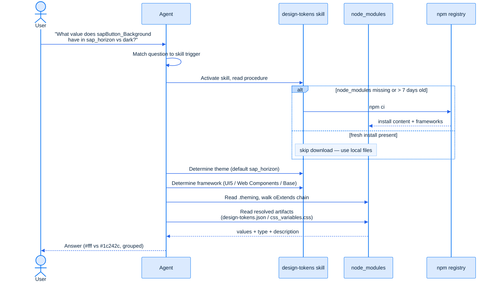

# UI Theme Designer Plugin

Plugin for coding agents working with the [SAP UI Theme Designer](https://help.sap.com/docs/btp/sap-business-technology-platform/sap-ui-theme-designer) on SAP BTP and the [SAP Fiori design token system](https://github.com/SAP/theming-base-content).

The SAP Design System is implemented as a two-layer architecture: **design tokens** (LESS/CSS custom properties in [`@sap-theming/theming-base-content`](https://www.npmjs.com/package/@sap-theming/theming-base-content)) that are consumed by **UI framework components** ([SAPUI5/OpenUI5](https://github.com/SAP/openui5), [UI5 Web Components](https://github.com/SAP/ui5-webcomponents), [Fundamental Styles](https://github.com/SAP/fundamental-styles)). Working across this stack without tooling means grepping multiple npm packages, tracing LESS inheritance chains through `.theming` JSON files, and cross-referencing live SAP Help documentation — all manually. This plugin automates that.

## Skills

### `ui-theme-designer-design-tokens`

Reads the locally installed npm packages of the SAP Design System to answer questions about design tokens and their consumption by UI framework components.

**What it gives you technically:**

- **Parameter values per theme** — reads `css_variables.css` from `@sap-theming/theming-base-content` for any standard theme (`sap_horizon`, `sap_horizon_dark`, `sap_horizon_hcb`, `sap_fiori_3`, `sap_belize`, …) and returns exact resolved CSS custom property values
- **Theme inheritance chains** — follows `oExtends` pointers across `.theming` JSON files to reconstruct the full inheritance graph; merges LESS files in inheritance order so you see the effective value at each level
- **LESS annotation semantics** — parses `// [Tags "..."]` and `// [Protected "..."]` annotations (including anti-values like `// [Protected "!true"]` that cancel parent annotations) to tell you whether a parameter is customer-editable or protected
- **Cross-framework blast radius** — for a given parameter, finds every component CSS file in UI5 Web Components (`@ui5/webcomponents*/src/themes/*.css`), SAPUI5/OpenUI5 (`@openui5/themelib_*/src/**/*.less`), and Fundamental Styles (`fundamental-styles/dist/*.css`) that references it
- **Component-to-token reverse lookup** — given a component name, locates its theme-independent CSS skeleton plus its `base/` and `<theme>/` delta files to show exactly which tokens it consumes

Use this skill when your question is: *"what value does parameter X have"*, *"which components use parameter X"*, *"which parameters control component Y"*, *"what changed between theme A and theme B"*, or *"is parameter X protected from customer overrides"*.

### `ui-theme-designer-help`

Fetches the [UI Theme Designer documentation](https://help.sap.com/docs/btp/sap-business-technology-platform/sap-ui-theme-designer) live from `help.sap.com` via its JSON API and answers questions about how the service works.

**What it gives you technically:**

- **Service configuration** — SAP BTP CF setup, Application Router integration, role collections, service plans and metering
- **Theme lifecycle** — creating, editing, publishing, transporting (manual ZIP or SAP Content Agent Service + Cloud Transport Management), and deleting themes and theme sets
- **Theme sets** — how `prefers-color-scheme` / `prefers-contrast` media feature matching selects appearances at runtime; why all referenced themes must be published independently
- **Integration mechanics** — how to pass `sap-theme=${themeId}@${themeRoot}` to SAPUI5 (URL param, bootstrap, `globalThis["sap-ui-config"]`), the `/themeinfo/v1` and `/themelist/v1` API endpoints for resolving optimized theme roots, self-hosting with `css_variables.css` as the sole required file
- **Service constraints** — 10 MB ZIP limit, 100 themes per subaccount, 30 req/s rate limit on theming-runtime, 8 req/s on theming-repository, HTTP 429 on breach
- **Themeable CSS guidance** — modern CSS-only approach (`var(--sap...)`, `@property`, CSS relative colors, container style queries) for custom UI5 controls without a LESS build step
- **What's new** — fetched live, so answers always reflect the current release

Use this skill when your question is: *"how do I configure X"*, *"what are the limits for Y"*, *"how does Z work in the UI Theme Designer service"*, or *"what does the documentation say about W"*.

## Installation

### For Claude

```sh
claude plugin install ui-theme-designer@claude-plugins-official
```

See [Claude by Anthropic: ui-theme-designer](https://claude.com/plugins/ui-theme-designer).

### For GitHub Copilot

```sh
copilot plugin install ui-theme-designer@awesome-copilot
```

See [Awesome GitHub Copilot: ui-theme-designer](https://awesome-copilot.github.com/plugin/ui-theme-designer/).

### For other coding agents

If your coding agent doesn't support plugins, install the skills directly using the [skills](https://www.npmjs.com/package/skills) package:

```bash
npx skills add SAP/ui-theme-designer-plugins-for-coding-agents
```

See [The Agent Skills Directory: SAP/ui-theme-designer-plugins-for-coding-agents](https://www.skills.sh/?q=SAP/ui-theme-designer-plugins-for-coding-agents).

## How Does the Design Tokens Skill Work?

The `ui-theme-designer-design-tokens` skill does not rely on the agent's training data for parameter values. Instead, it works against the actual source-of-truth artifacts published on npm. When your question matches one of the skill's triggers, the agent activates the skill and reads its procedure. If the local `node_modules` are missing or older than seven days, the skill runs `npm ci` to pull the current theming base content and framework packages; otherwise it reuses the files already on disk. It then determines the relevant theme (defaulting to `sap_horizon`) and framework (UI5, UI5 Web Components, or the base content), follows the `.theming` inheritance chain via the `oExtends` links, and reads the resolved artifacts — `design-tokens.json` or `css_variables.css`. The answer it returns is grounded in those files, including each parameter's value, type, and description.



## What can I do with this?

Real-world tasks where the UI Theme Designer plugin makes your coding agent immediately useful.

### 1. Assess the Impact of a Parameter Change

**Situation:** Before changing a design token (e.g. adjusting `sapBrandColor` or a tile background color in a custom theme), you want to know which components and CSS properties will be affected — so you can review visually and catch unintended regressions early.

**Example:**

> _"Which UI5 Web Components and CSS properties use `sapTile_Background`? I want to understand the blast radius before I change its value."_

**What happens:** The `ui-theme-designer-design-tokens` skill searches the component source of UI5 Web Components, SAPUI5/OpenUI5, and Fundamental Styles for every reference to the parameter. You get a grouped list of affected components and usage contexts — without grepping multiple repositories yourself.

---

### 2. Explore Parameter Dependencies for a Specific UI Area

**Situation:** You are theming a specific part of the UI (e.g. focus indicators, form fields, or navigation) and need to discover all related parameters — including ones you did not know existed.

**Example:**

> _"What theming parameters control the focus ring appearance across SAPUI5 components?"_

**What happens:** The skill maps the `sapContent_Focus*` namespace across UI technologies, shows which parameters exist, what values they carry in each standard theme, and which components consume them. A fragmented multi-repo search becomes a single structured answer.

---

### 3. Compare a Parameter's Value Across All Standard Themes

**Situation:** You are planning a migration from `sap_fiori_3` to `sap_horizon`, or building a multi-theme-aware custom component, and need to know how a specific parameter's value differs between themes.

**Example:**

> _"What value does `sapHighlightColor` have in `sap_horizon`, `sap_horizon_dark`, `sap_fiori_3`, and `sap_belize`?"_

**What happens:** The skill traverses the theme inheritance chain for each requested theme and returns the resolved values side by side — useful for contrast checks, migration planning, and dark-mode testing without needing a running system.

---

### 4. Find All Parameters That Changed Between Two Themes

**Situation:** You are migrating a custom theme from `sap_fiori_3` to `sap_horizon` and want to know which parameters were added, removed, or changed in value — so you can update your overrides systematically.

**Example:**

> _"Which parameters exist in `sap_horizon` but not in `sap_fiori_3`, and which have different values?"_

**What happens:** The skill traverses the full parameter set of both themes and returns a structured delta — new parameters, removed parameters, and value changes — giving you a migration checklist grounded in the actual theme data.

---

### 5. Check Service Limits Before a Production Rollout

**Situation:** You are preparing to roll out a custom theme to production and want to know whether there are size limits, rate limits, or other service constraints that could affect your deployment.

**Example:**

> _"What are the size and rate limits for custom themes in the UI Theme Designer on BTP? Are there restrictions I should know about before publishing?"_

**What happens:** The skill retrieves the "Theme Limits and Restrictions" and "Rate Limitation" documentation and returns the current limits — so you can validate your theme against them before hitting a constraint in production.

---

### 6. Understand Theme Sets and When to Use Them

**Situation:** You have heard about theme sets but are not sure when to use one instead of a standalone theme. You want to understand the concept before deciding on your theming architecture.

**Example:**

> _"What is a theme set in the UI Theme Designer, and when would I use one instead of a regular theme?"_

**What happens:** The skill retrieves the "What is a Theme Set?" and "Customizing Theme Sets" documentation and explains the use case — a theme set bundles multiple themes (e.g. light + dark + high-contrast variants) under a single identifier, so applications can switch between them automatically based on user or system preferences.

---

### 7. Find Out What's New in the Latest Release

**Situation:** You are a theming administrator or developer catching up after a release cycle and want to know what new features or changes were introduced in the UI Theme Designer recently.

**Example:**

> _"What new features were added to the UI Theme Designer recently?"_

**What happens:** The skill retrieves the "What's New for UI Theme Designer" documentation and returns the latest release notes — so you can quickly identify new capabilities, changed behavior, or deprecated features relevant to your theming setup.

---

## Examples

Examples showing in which situations the UI Theme Designer plugin can help you.

### Develop a Custom Component Using Design Tokens of Similar Components

**Situation:** You are building a custom component library and want to add a new component that looks consistent with the SAP Design System. The UI technology doesn't matter — this works with UI5, UI5 Web Components, or any other framework. To make the component themable, you want to reuse the SAP design tokens that standard components of the same type already use.

**Example:** You want to build a `ThemeCard` component that displays a preview of an SAP theme. Instead of guessing which parameters to use, ask:

> _"I want to develop a card control to display a preview of a SAP theme. Please list existing card parameters I can use in the CSS."_

**Result:** The agent returns the theming parameters that the UI5 Web Components `Card` uses, grouped by purpose. UI5 Web Components serve as the reference implementation of the SAP Design System, so the skill defaults to them when no UI framework is specified — for example:

| Purpose | Parameters |
|---|---|
| Background & border | `--sapTile_Background`, `--sapTile_BorderColor`, `--sapTile_BorderCornerRadius` |
| Elevation | `--sapContent_Shadow0` (default), `--sapContent_Shadow2` (hover) |
| Title text | `--sapGroup_TitleTextColor`, `--sapFontHeaderFamily`, `--sapFontHeader6Size` |
| Header separator | `--sapTile_SeparatorColor` |
| Focus ring | `--sapContent_FocusColor`, `--sapContent_FocusWidth`, `--sapContent_FocusStyle` |

You can use this list directly in your CSS, reference it in a feature description ("the ThemeCard should look like standard cards"), or let the agent propose a full CSS implementation based on it.

### Slim Down Your Custom CSS in existing Custom Themes

**Situation:** Over time, custom themes accumulate custom CSS that targets UI5 (or Unified Rendering) classes — often written to recolor or restyle something that had no theming parameter at the time. But new parameters are added to the SAP Design system over time. Custom CSS that was necessary a year ago may be completely redundant today, and it silently overrides the theme instead of following it. You want to know which of your custom CSS rules can simply be **deleted** because a theming parameter now covers them.

**Example:** Your custom theme contains this CSS, originally added to force the text color of neutral icon tab filters:

```css
/* Custom CSS */
.sapMITBTextOnly .sapMITBFilterNeutral .sapMITBText,
.sapMITBTextOnly .sapMITBFilterNeutral .sapMITBFilterWrapper:hover .sapMITBText,
.sapMITBTextOnly .sapMITBFilterNeutral .sapMITBFilterExpandBtn:hover .sapMITBFilterExpandIcon,
.sapMITBTextOnly .sapMITBFilterNeutral.sapMITBSelected .sapMITBFilterExpandBtnSeparator {
  color: #131e29;
}
```

You ask:

> _"Review this custom CSS from my theme. Can I remove any of it because a theming parameter now exists for it?"_

**Result:** The agent recognizes that these classes belong to the UI5 `IconTabBar` and that a dedicated parameter now controls exactly this color:

> Remove these six lines of custom CSS. The neutral icon tab filter text color is now driven by the `sapTab_Neutral_TextColor` theming parameter. Instead of overriding it in custom CSS, set `sapTab_Neutral_TextColor` to `#131e29` in your theme.

The custom CSS could be removed, the color becomes a first-class theme parameter, and it stays consistent across theme updates and inheritance instead of being pinned by a hard-coded override.
